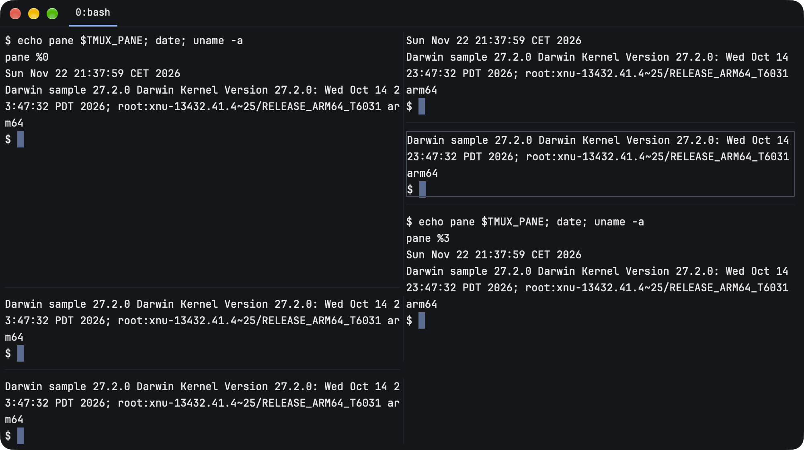
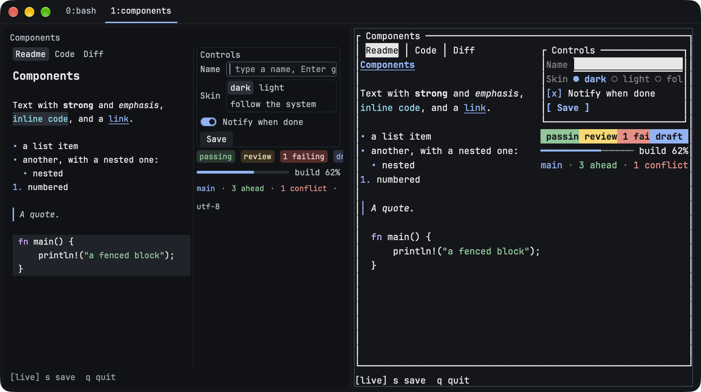

# Dreamer


A terminal for macOS and Linux where your shells, your agents, and small
apps share one workspace.

Dreamer draws every [tmux](https://github.com/tmux/tmux) pane as its own
native surface. tmux still owns your sessions, so they outlive the window
and everything that works in tmux works here. Around that, Dreamer adds
what a plain terminal lacks: agents that can see and drive panes with your
permission, panes that hold apps and web pages, and a daemon that keeps
watching your output when the window is closed.



## Install

```sh
curl -fsSL https://github.com/probablyrobot/dreamer/releases/latest/download/install.sh | sh
```

This installs the latest release without root: `Dreamer.app` on macOS 15 or
later (Apple Silicon), or the desktop and tools under `~/.local` on Linux
(x86-64 and ARM64). You need tmux installed. Update later with
`dream update`.

There are also `.deb` and `.rpm` packages and plain archives on the
[releases page](https://github.com/probablyrobot/dreamer/releases).
[Installing Dreamer](docs/install.md) has every option, including how to
uninstall.

## What you get

- **A native terminal on tmux.** Splits, tabs, windows, and sessions are
  real tmux objects, drawn on the GPU with one theme across the terminals
  and the window. Close the window and nothing stops.
  [The desktop app](docs/desktop.md)
- **Agents in panes.** Run pi, Claude Code, Codex, or any ACP agent beside
  your shells. Each uses its own login. What an agent may read or touch is
  a grant you choose, and anything beyond it asks you first.
  [Agents](docs/agents.md), [grants](docs/grants.md)
- **Your panes as tools.** An MCP server lets the agent you already use
  read panes, run commands, watch for output, and arrange the layout.
  [MCP](docs/mcp.md)
- **Output you can query.** Filters act on lines as they appear. Collectors
  turn output into rows: test failures, commands and exit codes, errors.
  [Filters](docs/filters.md), [collectors](docs/collectors.md)
- **Apps in panes.** A small manifest or a TypeScript file becomes a table,
  a form, a chart, or a chat in a pane, drawn natively in the desktop and
  as a TUI everywhere else. [Pane apps](docs/termapp.md)
- **Web pages in panes** on macOS, through a Chromium component installed
  on demand. [Web panes](docs/desktop.md#web-panes)
- **Remote hosts over SSH.** The same panes, agents, and tools on another
  machine, with no listener on either side. [Remote hosts](docs/remote.md)
- **A command line for all of it.** `dream` does everything the window
  does, with no window. [dream](docs/cli.md)



The same pane app, drawn natively by the desktop (left) and as a TUI in a
terminal pane (right).

## First steps

```sh
open -a Dreamer            # macOS; on Linux run `dreamer`
dream ls                   # sessions, windows, and panes
dream themes               # color schemes; set one in dreamer.yaml
dream skills install       # teach Claude Code and Codex to configure Dreamer
```

Settings live in `~/.config/dreamer/dreamer.yaml` and apply as you save.
[Settings](docs/settings.md) lists every key.

## Documentation

[The documentation index](docs/README.md) lists every page. The ones most
people want:

| To | Read |
| --- | --- |
| Install, update, uninstall | [Installing Dreamer](docs/install.md) |
| Learn the window, keys, and palette | [The desktop app](docs/desktop.md) |
| Change fonts, themes, and behavior | [Settings](docs/settings.md) |
| Describe a session in a file | [Workspaces](docs/workspaces.md) |
| Run and connect agents | [Agents](docs/agents.md), [MCP](docs/mcp.md) |
| Work on another machine | [Remote hosts](docs/remote.md) |
| Build an app for a pane | [Pane apps](docs/termapp.md) |
| Write an extension in Rust | [Extensions](docs/extensions.md) |

## Status

Dreamer is at version 0.10 and changes quickly. macOS on Apple Silicon is
the most used platform. Linux packages are built and checked for every
release; web panes are not available on Linux yet.
[Terminal compatibility](docs/terminal-compatibility.md) and
[performance](docs/performance.md) record what is tested and measured.

## Building from source

```sh
cargo xtask doctor
cargo xtask deps prepare
cargo build --workspace --locked
```

[Building Dreamer](docs/building.md) explains the prerequisites, the
checks, and the layout of the repository.

## License

Apache-2.0. See [LICENSE](LICENSE), [NOTICE](NOTICE), and
[THIRD_PARTY_NOTICES.md](THIRD_PARTY_NOTICES.md).
